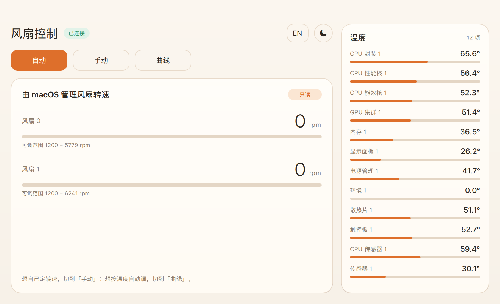
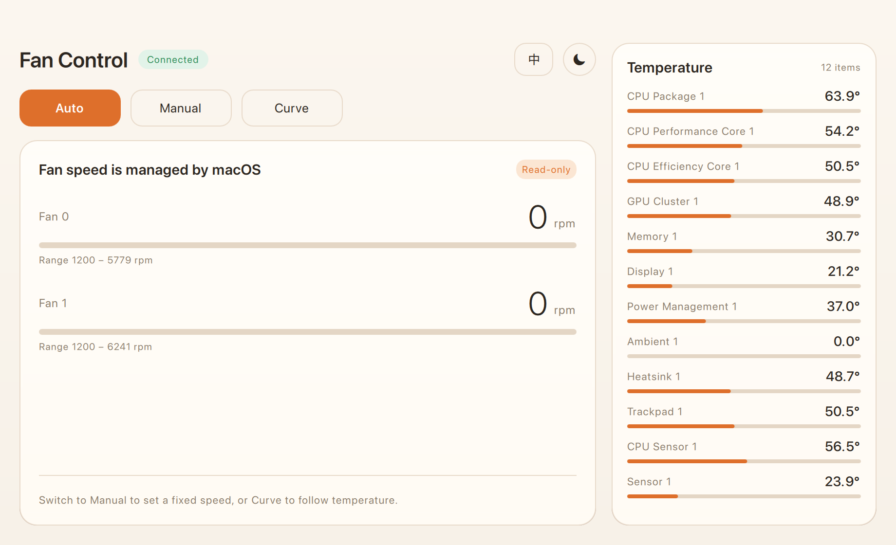
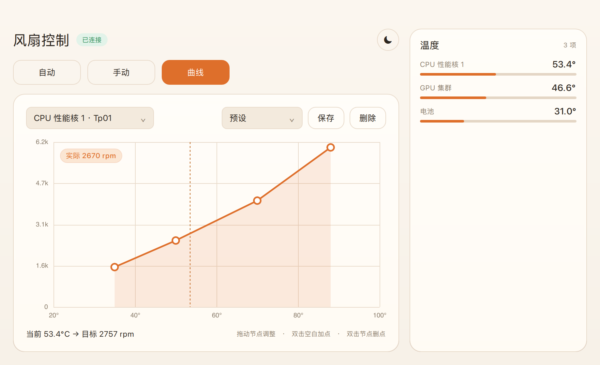

# FanCtl

A native fan control app for Apple Silicon Macs. Qt 6 / QML interface, a small root
helper that talks to the AppleSMC, live temperature sidebar, draggable fan curve with
presets, day/night themes, Chinese/English UI, and a menu-bar companion.

一个 macOS 风扇控制小工具：QML 界面 + 独立 root helper 写 SMC，支持实时温度、可拖拽
风扇曲线与预设、日夜主题、中英文切换、菜单栏常驻。C++20 + Qt 6 + CMake。



> **⚠️ 使用警告 / Warning**
>
> 这个程序会直接写 AppleSMC 控制风扇转速。写错参数可能导致风扇停转、噪音变大或
> 散热不足。请自行判断是否使用，作者不对任何硬件损坏负责。
>
> This app writes to the AppleSMC to control fan speed. Wrong values can stop the fans,
> make them noisy, or leave the machine under-cooled. Use at your own risk — no warranty
> of any kind. Read the **诊断 / 验证** section before trusting it on your machine.

## 设计目标

**对用户来说只有一个 App。** 后台那个以 root 运行的小组件（用来写 SMC）对使用者完全透明：

- 第一次打开：点一次「启用风扇控制」，输一次管理员密码，之后不再需要；
- 之后每次打开：直接用，没有插件、没有安装向导、没有终端；
- 关闭窗口：自动把风扇交还系统，然后退出。

## 项目结构

```
CMakeLists.txt
build.sh                    构建脚本（绕过未接受的 Xcode 许可）
src/
  core/
    smc.h/.cpp              AppleSMC 协议客户端（含字节序自适应、模拟器）
    ipc.h/.cpp              守护进程 <-> 前端 的行协议
    fancontroller.h/.cpp    QML 后端：状态、控制、诊断、验证、自动安装
  app/main.cpp              QML 引擎入口
  daemon/daemon.cpp         fanctld：root 守护进程 + 控制循环
  cli/cli.cpp               fanctl：命令行（诊断/验证/排错用）
qml/
  Main.qml                  窗口骨架：左功能区 + 右温度栏
  Theme.qml                 日间 / 夜间双主题（颜色、圆角、动效时长）
  Card.qml                  圆角卡片（投影 + 悬停上浮）
  ModeButton.qml            模式按钮（按下回弹）
  IconButton.qml            圆形图标按钮（主题切换）
  FanSlider.qml             手动模式的风扇滑杆
  AutoPanel.qml             自动模式：只读展示系统转速
  ManualPanel.qml           手动模式
  CurvePanel.qml            曲线模式
  TempSidebar.qml           右侧固定温度栏
  Stepper.qml               数值步进器
  DarkComboBox.qml          下拉框
packaging/
  Info.plist.in
  com.fanctl.daemon.plist   随 App 一起打包，安装时复制到 LaunchDaemons
docs/                       截图
install.command             可选：从终端安装（App 也能自己装）
restart-daemon.command      可选：后台组件没起来时手动重启
```

分层：`core` 不依赖界面；`fancontroller` 只依赖 QtCore；QML 只依赖 `controller`
一个对象。守护进程和 CLI 不链接 Qt，保持最小依赖。

## 构建

```bash
./build.sh
```

脚本做三件事，因为这台机器上 `/usr/bin/clang` 会以「未接受 Xcode 许可」拒绝运行：

1. 直接用 Xcode 内部的 `clang++` / `ld` / `make`；
2. 显式指定 `-isysroot` 指向 Xcode 里的 macOS SDK；
3. 在 `CMakeLists.txt` 里预定义 `WrapOpenGL::WrapOpenGL`，绕开 Qt 对早已消失的
   `AGL.framework` 的引用。

产物：`build/FanCtl.app`（内含 `fanctld`）、`build/fanctl`、`build/fanctld`。

## 打包成可分发版本

`./build.sh` 出来的 App 依赖 Homebrew 的 Qt（绝对路径），只能在本机跑。要拷到别的
Mac 上用：

```bash
./package.sh          # 产出 dist/FanCtl.app
```

它会把 Qt 框架、插件、QML 模块全部塞进 bundle 并重写依赖路径，产物约 89 MB，
运行时不再引用 `/opt/homebrew`（可用 `DYLD_PRINT_LIBRARIES=1` 验证）。

| 项目 | 情况 |
|---|---|
| Apple Silicon（M 系列） | ✅ 可用（arm64） |
| Intel Mac | ❌ 没有 x86_64 切片，需另行交叉编译 |
| macOS 版本 | 13.0 及以上（`LSMinimumSystemVersion`） |
| 签名 / 公证 | 仅 ad-hoc 签名，未公证；首次打开要右键 →「打开」，或 `xattr -dr com.apple.quarantine` |
| 权限 | 第一次点「启用」需一次管理员授权（安装后台组件） |

不同机型的 SMC key 可能不一样：程序会自动适配字节序，进 App 点「诊断」就能判断这台机器
是否支持；无风扇机型（如 MacBook Air）会显示没有可控制的风扇。

## 使用

打开 `build/FanCtl.app`（或装到 `/Applications` 后打开）。

界面分成两块：**左边是功能区域，右边是固定的温度栏**。顶部三个按钮切换模式，
只有左边的功能区域会变，温度栏始终在。

| 模式 | 功能区域 |
|---|---|
| 自动 | 显示系统当前的转速，只读；风扇完全交给 macOS 调度 |
| 手动 | 拖动滑杆**或直接输入数字**设定目标转速，同时显示实际转速 |
| 曲线 | 折线图：拖节点调整、双击加点/删点、多套预设 |

右上角两个按钮：`EN / 中` 切换界面语言，`☾ / ☀` 切换主题，两者都会被记住。



主题说明：

- **日间**：暖白纸张底 + 米色卡片 + 橙调强调色，不再是一片刺眼的纯白；
- **夜间**：暖褐深色，卡片比背景略亮并带一条 1px 顶部高光，避免糊成一块；
- 温度栏、徽章、状态胶囊都跟随主题，不再有硬编码的白底/绿底。

### 窗口外观

去掉了 macOS 的标题栏：`NSWindowTitleHidden` + `titlebarAppearsTransparent` +
`fullSizeContentView`，窗口内容一直画到顶部和圆角，红绿灯按钮浮在内容上。
窗口外观还会跟随主题切换（`NSAppearance` Aqua / DarkAqua），避免深色标题栏配浅色界面的割裂感。

标题栏隐藏后 Qt 的内容视图会盖住原本可拖拽的区域，所以顶部 128px 由 QML 的
`MouseArea` 接管（在内容下方，按钮/滑杆仍优先响应），按下时调用
`performWindowDragWithEvent:` 让系统接管拖动。

几个坑：窗口未激活时第一下点击只会激活 App，拖拽会被吞掉，所以拖动前会先
`activateIgnoringOtherApps` + `makeKeyAndOrderFront`；另外取消了双击缩放，避免快速
两次点击被识别成双击而不是拖动。代码在 [native_mac.mm](src/app/native_mac.mm) 和
[Main.qml](qml/Main.qml)。

### 为什么拖起来不卡

守护进程把传感器读数缓存在后台线程里，`STATUS` 直接返回快照，不再每次请求都去读
205 个传感器。实测往返从 **62 ms 降到 2.6 ms** —— 之前每 1.2 秒卡一下，正好被感知成
「拖窗口不跟手」。

### 固定尺寸

窗口固定为 920 × 560：QML 里 `minimumWidth/Height` 与 `maximumWidth/Height` 都锁死，
同时在原生侧去掉 `NSWindowStyleMaskResizable` 并清掉 `FullScreenPrimary` 行为，
所以绿色按钮变灰、边缘不能拉伸、也不响应 `⌃⌘F` 全屏。

### 交互细节

- 卡片是「远处散光 + 近处投影」两层 + 表面细微渐变，悬停时整体上浮 3px 并加深阴影；
- 按钮按下会回弹（0.96 缩放），松开恢复；
- 滑杆：蓝色圆点 = 目标转速，白色刻度 = 实际转速，两者不会互相拉扯；
- 手动模式下**滑杆只归用户所有**：后台刷新不再回写滑杆值，只在「首次加载」和
  「切回手动模式」时同步一次。松手后无论刷新返回什么都影响不到手柄，从根上消除闪回；
- 输入框在编辑时不会被刷新覆盖；回车应用并收起光标，点窗口任意空白处也会失焦；
- 温度栏只列每个类别里最靠前的传感器，顺序固定，不会随温度高低跳动。
### 后台常驻

- 关闭窗口**不会退出**，只是收起界面，App 继续在菜单栏运行；
- 菜单栏图标显示当前状态：自动模式显示「自动」，手动/曲线模式下显示实时转速（如 `2.7k`）；
- 点菜单栏图标：`显示主窗口` / `自动控制` / `退出 FanCtl`；
- 只有选「退出」才会结束进程，并在退出时把风扇交还系统（`AUTO`）；
- **单实例**：重复打开只会唤出已有窗口，不会出现第二个菜单栏图标；
- 因为常驻菜单栏，App 不显示 Dock 图标（`LSUIElement`）。

### 曲线

> 曲线协议在 1.2 版本改成了任意多点折线（`CURVE <sensor> <n> ...`）。
> 旧的守护进程不认这个格式，标题栏会显示「组件需更新」——跑一次
> `./install.command` 即可。客户端也会拦住这类操作并提示，不会静默失败。




- 横轴温度、纵轴转速，黄色虚线是当前温度；
- 图表左上角浮着一个「实际 xxxx rpm」的胶囊，实时刷新，不额外占布局空间；
- **拖动节点**直接改曲线，松手后立刻应用；相邻节点互相约束，不会交叉；
- **双击空白**加一个点，**双击节点**删掉（至少保留两个）；
- 温度来源从右侧固定温度栏的那 12 个里选，不用在 200 个传感器里翻；
- 传感器名称、诊断信息、状态栏文案都跟随语言切换；
- 预设：`保存` 起名入库、下拉选择即套用、`删除` 移除。预设存在 `QSettings` 里，
  换版本也不会丢；内置「安静 / 均衡 / 性能」三套作为起点。

### 滑杆的两种含义

滑杆**只表示你要的目标转速**；实际转速是轨道上那条白色细刻度 + 右上角「实际 XXXX」。
风扇加速需要时间，所以松手后蓝色圆点停在目标位置，白色刻度慢慢追上来——两者不再互相拉扯。
「自动」模式下没有用户目标，滑杆变为只读，仅用来显示当前实际位置。

### 温度的顺序

传感器按「类别 + key」固定排序，温度高低不会改变顺序：

`CPU 封装 → CPU 性能核 → CPU 能效核 → GPU 集群 → 内存 → 电池 → 显示面板 → …`

温度卡片每个类别只取第一个（如「CPU 性能核 1」），所以四张卡片的位置永远不变，
只有数字在跳。

### 温度标签

SMC 的 4 字符 key 会被翻译成中文名：`Tp0x` → CPU 性能核、`Te0x` → CPU 能效核、
`Tg0x` → GPU 集群、`TB0x` → 电池、`TCMz` → CPU 封装、`TPUx` → 电源管理……
编号按同类 key 排序生成，稳定且连续；曲线下拉框里还能看到原始 key。

## 架构

```
FanCtl.app (QML)          fanctld (root, LaunchDaemon)
      │                            │
      │  unix socket 0660          │  IOKit / AppleSMC
      └──── STATUS / MANUAL ───────┘
            CURVE / AUTO             读：免权限   写：需要 root
```

读 SMC 不需要 root，所以诊断由 App 自己完成；写 SMC 必须 root，所以统一交给
守护进程。App 内置了 `fanctld` 和 LaunchDaemon 配置，第一次点「启用」时通过
`osascript ... with administrator privileges` 完成安装与加载，用户不需要接触终端。

## 关于 SMC 字节序

传统 AppleSMC 用大端、key 原样；这台 M1 Pro 上的 SMC 是**小端**、而且部分
key 名是**倒序存储**（`FNum` 存成 `muNF`）。`smc.cpp` 会：

1. 枚举一次全部 key，建立别名表（`FNum → muNF`），两种写法都能查到；
2. 用 `F0Mn`/`F0Mx` 的读数双向试解，落在 100–20000 rpm 的那个就是正确字节序；
3. 类型串、写入编码使用同一约定。

所以同一份代码在经典 Mac 和这台机器上都能工作。诊断面板里的「数值字节序」
会告诉你当前用的是哪一套。

## 验证是否可行

App 里点「诊断」会给出结论；命令行等价物：

```bash
./build/fanctl doctor      # 只读，不需要 root
./build/fanctl selftest    # 端到端实测，结束自动还原
```

## 故障排查

**「后台组件没有运行」**

点界面上的「启动」即可（需要一次授权）。命令行等价：

```bash
./restart-daemon.command
```

**看状态 / 日志**

```bash
launchctl print system/com.fanctl.daemon | head -5
ls -l /var/run/fanctl.sock
tail -20 /var/log/fanctl.log
```

`bootout` 是异步的，紧接着 `bootstrap` 会报 "Operation already in progress"。
`restart-daemon.command` 和 `install.command` 都会等旧实例真正消失再加载。

## 已知限制

- 只处理 `flt ` / `fpe2` / `ui16` / `ui8 ` 四种风扇数据类型；
- 曲线是单段线性映射，没有多点折线；
- 没有实现「多个预设一键切换」。
